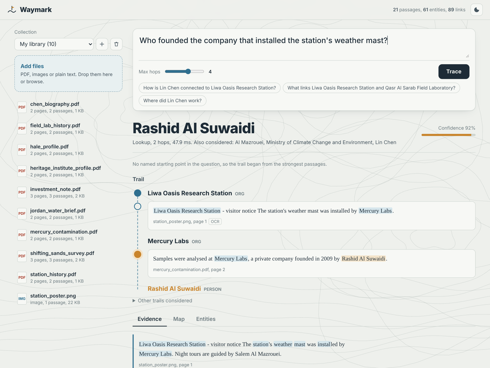

# Waymark

Waymark reads long PDFs, scans and images, builds a knowledge graph out of them, and answers questions that need several hops through that graph. Every answer comes with the trail that produced it: which entity led to which, through which sentence, on which page.

It does not call a language model. The whole pipeline is classical NLP (spaCy), sparse linear algebra (SciPy) and graph search, so it runs on a laptop CPU, works offline, and gives the same answer to the same question every time.



## Why it exists

General chat assistants are good at summarising a document. They are much less reliable at the opposite job: noticing that a name on page 12, a footnote on page 230 and a figure caption in a scanned appendix are three steps of the same chain. Those links are rarely written down in one place, and long contexts tend to blur them.

The hard part of doing this with a graph is not the graph. It is deciding which mentions are the same thing. Treat every surface string as one node and the graph collapses: two researchers called Chen become one person, Jordan the country absorbs Jordan the geologist, and every path through either of them is wrong. Waymark resolves entities by where they sit rather than by how they are spelled.

## How it works

```
PDF / image / text
   │  PyMuPDF text blocks, headings → passage titles, OCR for scanned pages and figures (RapidOCR)
   ▼
passages ── spaCy: sentences, lemmas, named entities, noun-phrase concepts, dates and quantities
   ▼
entity resolution
   │  context vectors: tf-idf of the surrounding sentence window
   │  landmarks: unambiguous multi-word names used as fixed reference points in that vector
   │  long names settle first; short forms ("Chen", "WHO", "Mercury") attach to them only
   │  when the local context agrees, otherwise they stay separate senses
   │  one sense per document, NER label conflicts split senses, pronoun and
   │  "the institute"-style references link back to their antecedent
   ▼
graph: entities ↔ sentences ↔ passages, co-occurrence edges, BM25 indices
   ▼
question reading: anchors (with sense choice), relation plan ("the father of the director of X"
   becomes director → father), expected answer type, comparison and connection modes
   ▼
retrieval: personalised PageRank seeded by the anchors, blended with BM25
   ▼
trail search: beam search over sentences, one relation per hop, cue coverage,
   kinship direction and gender agreement, date roles in "(1919 – 2006)" spans
   ▼
answer + ranked trails + evidence passages + subgraph
```

Question modes:

| Mode | Example |
| --- | --- |
| Lookup across hops | Which institute funds the lab where the author of the dune survey trained? |
| Comparison | Which was founded earlier, the research station or the heritage institute? |
| Same-attribute check | Do both films have directors from the same country? |
| Connection | How is Jordan Hale connected to the Al Dhafra Heritage Institute? |

## Results

Measured with `python -m scripts.bench` on the evaluation sets HippoRAG uses (1,000 questions each, retrieval over the full corpus of every set, no LLM anywhere). Recall@k is the share of gold supporting passages in the top k.

| Set | Passages | Recall@2 | Recall@5 | Exact match | F1 | ms / question |
| --- | ---: | ---: | ---: | ---: | ---: | ---: |
| 2WikiMultiHopQA | 6,119 | 76.1 | 91.3 | 47.5 | 51.9 | 47 |
| HotpotQA | 9,811 | 63.0 | 83.4 | 17.8 | 23.4 | 147 |
| MuSiQue | 11,656 | 43.0 | 57.9 | 5.3 | 7.3 | 159 |

For reference, the HippoRAG paper (NeurIPS 2024, LLM-built graph) reports Recall@2/@5 of 41.0/52.1 on MuSiQue, 71.5/89.5 on 2Wiki and 59.0/76.2 on HotpotQA, and BM25 reaches 32.3/41.2, 51.8/61.9 and 55.4/72.2.

Exact match is lower than what an LLM reader gets on the same retrieval, mostly on questions whose answer is a phrase rather than a name, date or place. Waymark returns the evidence trail for those instead of inventing a sentence.

Scale: the 2Wiki paragraphs behind 200 questions, shuffled into a single 482-page PDF so that each hop lands on an unrelated page, index in about 14 seconds on two CPU cores. Questions against it take around 20 ms and score 44.5 exact match, close to the 49.0 the same questions get against the clean passage corpus.

## Install

Python 3.10 to 3.13.

```bash
python -m venv .venv
source .venv/bin/activate          # Windows: .venv\Scripts\activate
pip install -r requirements.txt
```

`requirements.txt` pulls the `en_core_web_md` spaCy model from its GitHub release. If you install dependencies another way, run `python -m spacy download en_core_web_md`. The OCR models ship inside the `rapidocr` wheel, so nothing else is downloaded at run time.

## Run

```bash
python -m waymark
```

Open http://127.0.0.1:8000, drop files into the library, and ask. Options:

```bash
python -m waymark --host 0.0.0.0 --port 8080 --data-dir /var/lib/waymark
```

| Variable | Default | Meaning |
| --- | --- | --- |
| `WAYMARK_DATA_DIR` | `./data` | SQLite database, uploaded files and graph cache |
| `WAYMARK_SPACY_MODEL` | `en_core_web_md` | falls back to `en_core_web_sm` if missing |
| `WAYMARK_MAX_UPLOAD_MB` | `200` | per file |
| `WAYMARK_OCR` | `1` | OCR scanned pages, embedded figures and images |
| `WAYMARK_OCR_MIN_PAGE_CHARS` | `60` | pages with less extractable text are OCR'd |
| `WAYMARK_PASSAGE_CHARS` | `900` | target passage length |
| `WAYMARK_NLP_BATCH` | `48` | spaCy batch size |

Supported files: PDF, PNG, JPEG, WebP, BMP, TIFF, GIF, TXT and Markdown.

## Images

Images are read, not captioned. Each one gets OCR with line boxes (drawn over the image in the UI), a palette, brightness, contrast, colourfulness and edge density, a guess at what kind of picture it is (document, screenshot, diagram, photo) with the reasons, EXIF camera data, and every number found in it. The text joins the graph like any other passage, so a fact printed on a poster can be one hop of a trail that started in a PDF.

## API

| Method | Path | |
| --- | --- | --- |
| GET | `/api/health` | |
| GET, POST | `/api/collections` | list, create `{"name"}` |
| GET, PATCH, DELETE | `/api/collections/{cid}` | documents and running jobs |
| GET | `/api/collections/{cid}/stats` | graph size and resolver counters |
| POST | `/api/collections/{cid}/documents` | multipart `files`, returns job ids |
| DELETE | `/api/collections/{cid}/documents/{doc}` | |
| GET | `/api/jobs/{job}` | stage and progress |
| POST | `/api/collections/{cid}/ask` | `{"question", "max_hops"}` |
| GET | `/api/collections/{cid}/entities?q=` | search |
| GET | `/api/collections/{cid}/entities/{eid}` | aliases, senses, links, mentions |
| GET | `/api/collections/{cid}/graph?focus=1,2` | subgraph |
| GET | `/api/collections/{cid}/documents/{doc}/page/{n}` | rendered page PNG |
| GET | `/api/collections/{cid}/documents/{doc}/report` | image analysis |

Interactive docs live at `/api/docs`.

## Tests

```bash
pip install -r requirements-dev.txt
pytest
```

The suite generates its own corpus: nine PDFs (one padded to 120 pages so related facts sit far apart) and a poster image, written to contain the cases that break naive graphs: two different people called Chen, Jordan the country next to Jordan Hale the geologist, mercury the element next to Mercury Labs, pronoun-only sentences, and a fact that exists only in the image.

## Layout

```
waymark/
  config.py            settings from environment
  text.py              normalisation shared by every stage
  ingest/              PDF, image and text readers, OCR, chunking
  nlp/annotator.py     spaCy pass that produces sentences, mentions and values
  graph/
    corpus.py          flat arrays over passages, sentences and mentions
    landmarks.py       context vectors with landmark features
    resolver.py        entity resolution
    anaphora.py        pronoun and definite-description links
    index.py           graph, BM25 and topic structures
    explore.py         entity search, detail and subgraph views
    store.py           SQLite library and graph cache
  reasoning/
    question.py        anchors, relation plan, answer type, mode
    walker.py          personalised PageRank retrieval
    chains.py          trail search
    values.py          dates and numbers
    lexicon.py         relation and demonym tables
    engine.py          ties it together
  server/              FastAPI app and the ingest worker
  web/                 the interface (plain HTML, CSS and ES modules)
scripts/bench.py       benchmark runner
tests/
```

## Limits

- English only, because the spaCy model is English.
- Answers are entities, dates, numbers, yes/no or paths. Questions whose answer is a free-form phrase get the right evidence but a weaker headline answer.
- Entity types come from spaCy's statistical NER, so an occasional place tagged as a person is possible; resolution limits the damage but cannot remove it.
- OCR is CPU-bound. Scanned books of several hundred pages take minutes, not seconds.
